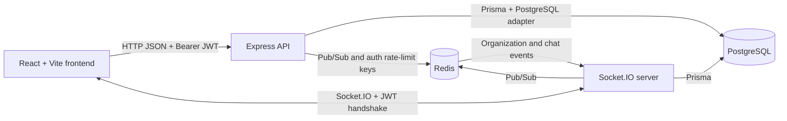

# OrgImpact

[Open the OrgImpact website](https://orgimpact.vercel.app) · [View the source repository](https://github.com/mohitsaini7407/OrgImpact)

OrgImpact is a multi-tenant organizational impact-analysis application. It helps teams map services and other organizational entities, record their dependencies, and understand which upstream entities may be affected when something changes or fails.

> **Demo access:** The following credentials were supplied for the demo. They are included here for convenience and have not been verified against the live site's current user database. They should only be used for a disposable demo environment, never for production or personal accounts.

| Demo account | Password |
| --- | --- |
| `dev@orgimpact.dev` | `dev@1234` |
| `owner@orgimpact.dev` | `owner@1234` |
| `admin@orgimpact.dev` | `admin@1234` |
| `member@orgimpact.dev` | `member@1234` |

## Table of contents

- [Overview and capabilities](#overview-and-capabilities)
- [Technology stack](#technology-stack)
- [Architecture](#architecture)
- [Repository layout](#repository-layout)
- [Prerequisites](#prerequisites)
- [Local development](#local-development)
- [Environment variables](#environment-variables)
- [Database and Prisma](#database-and-prisma)
- [User workflows and roles](#user-workflows-and-roles)
- [HTTP API reference](#http-api-reference)
- [Real-time events](#real-time-events)
- [Security notes](#security-notes)
- [Tests, builds, and troubleshooting](#tests-builds-and-troubleshooting)
- [Deployment](#deployment)
- [Contributing](#contributing)
- [Status and limitations](#status-and-limitations)

## Overview and capabilities

Organizations often depend on interconnected services, applications, databases, teams, and infrastructure. When one component fails or changes, it can be difficult to see what else may be affected. OrgImpact provides a shared, organization-scoped inventory and directed dependency graph to make those connections visible.

The application is intended for organization owners, administrators, and members who need to maintain a shared map of organizational entities, relationships, teams, and incidents.

Features present in the repository include:

- User registration, login, JWT-authenticated sessions, and profile-name updates.
- Multiple organization workspaces, organization creation, join-code requests, and owner approval or rejection.
- Organization invitations and membership role management.
- Organization-scoped entity types and relationship types.
- Entity inventory with descriptions and `LOW`, `MEDIUM`, `HIGH`, or `CRITICAL` criticality.
- Directed relationships between entities and a visual dependency graph.
- Upstream impact analysis from an entity, including affected nodes by depth.
- Incident creation, investigation/resolution status, incident impact, and notifications.
- Organization member, team, and team membership management.
- Direct and team conversations, persisted messages, typing indicators, and read receipts.
- Dark/light theme selection in the frontend.

### Example: tracing an incident

Suppose the graph contains these directed relationships:

```text
Customer API --DEPENDS_ON--> Orders service --DEPENDS_ON--> Orders database
```

If an incident affects **Orders database**, the impact analysis follows incoming dependency links upstream. It reports **Orders service** at depth 1 and **Customer API** at depth 2. This describes the graph's recorded dependency direction; it does not automatically assert that every reported service is unavailable.

## Technology stack

| Technology | Use in OrgImpact |
| --- | --- |
| React 19, TypeScript, Vite | Single-page frontend, typed UI components, and local frontend development/builds. |
| Custom CSS | Frontend styling and dark/light themes; the repository does not configure a utility-CSS framework. |
| `@xyflow/react` | Interactive entity graph rendering, nodes, edges, minimap, and graph controls. |
| Node.js 22 container base, TypeScript, Express 5 | HTTP API and Socket.IO server. Node 22 is the version used in the backend Dockerfile; local compatibility depends on the installed package versions. |
| PostgreSQL, Prisma 7, `pg`, `@prisma/adapter-pg` | Relational persistence and typed database access through Prisma's PostgreSQL adapter. A hosted PostgreSQL provider such as Neon can be used through `DATABASE_URL`; no provider-specific deployment setup is present. |
| Redis | Backend startup dependency for Pub/Sub event distribution and Redis-backed authentication rate limiting. |
| Socket.IO 4 | Authenticated real-time connections, organization updates, and chat events. |
| JSON Web Tokens (`jsonwebtoken`) | HS256 bearer-token authentication for HTTP and Socket.IO. |
| `bcryptjs` | Password hashing and comparison (registration hashes with cost factor 12). |
| Zod | Request-body validation for the schemas wired into API routes. |
| Oxlint | Frontend lint command. |

No email provider, email delivery configuration, CI workflow, or frontend hosting configuration is defined in the repository. The website URL above was supplied by the project owner.

## Architecture



### Request and data flow

1. The frontend sends JSON requests to the configured API origin. The default is `http://localhost:5000`.
2. Protected routes validate an `Authorization: Bearer <token>` JWT, then validate request data with their route's Zod schema and apply organization/role checks where required.
3. Controllers invoke service functions; services use the shared Prisma client and PostgreSQL adapter to read or change records.
4. Services publish selected organization events to Redis Pub/Sub. The server's subscriber forwards organization events only to that organization's Socket.IO room.
5. Chat is persisted in PostgreSQL. Chat events are distributed through Redis Pub/Sub to recipient-specific Socket.IO user rooms.

### Tenant boundaries

Organizations own their entities, teams, incidents, relationship types, and conversations. Organization membership middleware resolves the current user's membership and organization role. Entity, incident, relationship, team, and type middleware resolve organization scope from the requested resource. The impact and graph queries are scoped by organization ID.

These are application-level controls; database credentials and infrastructure should also be configured to prevent unauthorized access. Review all new queries and events for tenant scoping before merging changes.

### Redis and Socket.IO

The backend opens Redis clients during startup and subscribes to two Pub/Sub channels: `orgimpact:events` and `orgimpact:chat-events`. Redis is not merely an optional cache: startup connects to it, and authentication rate limiting also uses it. Local development defaults to `redis://localhost:6379`; production requires `REDIS_URL`.

## Repository layout

```text
OrgImpact/
├── README.md
├── .gitignore
├── frontend/
│   ├── .env.example
│   ├── package.json
│   ├── vite.config.ts
│   ├── public/                     # App icons and brand assets
│   └── src/
│       ├── App.tsx                 # Main workspace and feature screens
│       ├── Login.tsx
│       ├── OrganizationOnboarding.tsx
│       ├── socket.ts               # Socket.IO client
│       ├── graphRelationships.ts   # Graph filtering/layout helpers
│       ├── *.css                   # App, graph, and onboarding styles
│       └── *.test.ts               # Frontend tests
└── backend/
    ├── .env.example
    ├── Dockerfile
    ├── package.json
    ├── prisma.config.ts
    ├── prisma/
    │   ├── schema.prisma
    │   └── migrations/             # Ordered SQL migrations
    └── src/
        ├── app.ts                  # Express middleware and route mounts
        ├── server.ts               # DB/Redis startup and HTTP/Socket.IO setup
        ├── socket.ts               # Authenticated socket handlers
        ├── config/                 # CORS and production configuration
        ├── controllers/            # HTTP request/response handlers
        ├── generated/prisma/       # Generated by `prisma generate`; not committed
        ├── lib/                    # Prisma, Redis, and real-time helpers
        ├── middleware/             # Auth, validation, tenant checks, errors
        ├── routes/                 # Express routers and Zod schemas
        ├── services/               # Business logic and persistence
        └── types/                  # Express request type augmentation
```

There is no shared workspace-level package manifest. Install dependencies separately in `backend` and `frontend`. The generated Prisma client is excluded from source control and created by the Prisma generation step.

## Prerequisites

- Git.
- Node.js 22 recommended for parity with the backend Docker image. A compatible npm installation is included with Node.js.
- A PostgreSQL database reachable from the backend. This may be local or hosted (for example, a properly configured Neon PostgreSQL database).
- Redis reachable from the backend. Docker Desktop can run a local development Redis instance; a managed Redis service can be used for deployment.
- Docker Desktop only if using Docker to run Redis locally or to build/run the backend container.

The repository does not declare a PostgreSQL server version or provide a database container/compose file.

## Local development

### Initial setup

In PowerShell, clone the repository and install each application's locked dependencies:

```powershell
git clone https://github.com/mohitsaini7407/OrgImpact.git
Set-Location .\OrgImpact

Set-Location .\backend
npm ci
Copy-Item .env.example .env

Set-Location ..\frontend
npm ci
Copy-Item .env.example .env

Set-Location ..
```

Edit `backend\.env` with a reachable PostgreSQL connection string, a local JWT secret, and local Redis/frontend settings. For local development, the backend defaults to Redis at `redis://localhost:6379` and CORS origin `http://localhost:5173`, but `DATABASE_URL`, `JWT_SECRET`, and `JWT_EXPIRES_IN` must be supplied for the application flows to work. The frontend API variable can be set to `http://localhost:5000`.

If Docker Desktop is available, start Redis in a separate PowerShell terminal:

```powershell
docker run --name orgimpact-redis -p 6379:6379 -d redis:7-alpine
```

If that container already exists, start it with `docker start orgimpact-redis`. This local example exposes Redis without authentication; do not expose such a Redis instance to an untrusted network.

Create/provision the PostgreSQL database before applying migrations. Then generate the Prisma client and apply the checked-in migrations:

```powershell
Set-Location .\backend
npx prisma generate
npx prisma migrate status
npx prisma migrate deploy
```

`npm ci` runs the backend's `postinstall` script, which also generates Prisma Client. Running `npx prisma generate` explicitly is safe and makes the setup step visible.

### Start the app

Open two PowerShell terminals from the repository root.

Backend:

```powershell
Set-Location .\backend
npm run dev
```

Frontend:

```powershell
Set-Location .\frontend
$env:VITE_API_BASE_URL = "http://localhost:5000"
npm run dev
```

Open the Vite URL printed in the frontend terminal (normally `http://localhost:5173`). The backend health endpoint is:

```powershell
Invoke-RestMethod http://localhost:5000/health
```

Expected response:

```json
{
  "status": "ok",
  "service": "OrgImpact API"
}
```

### Normal development after initial setup

Start Redis and PostgreSQL if they are not already running, then run `npm run dev` in the backend and frontend terminals. Re-run `npx prisma migrate deploy` when pulling a change that adds a checked-in migration. Do not use a database reset command against data you need to keep.

## Environment variables

The checked-in examples are `backend/.env.example` and `frontend/.env.example`. The root and application `.gitignore` files exclude `.env` and `.env.*`, while allowing `.env.example`.

| Variable | Purpose | Required? | Example format (placeholder only) | Used by |
| --- | --- | --- | --- | --- |
| `DATABASE_URL` | PostgreSQL connection string used by Prisma's PostgreSQL adapter and Prisma CLI. | Yes | `postgresql://<user>:<password>@<host>:5432/<database>?schema=public` | Backend and Prisma CLI |
| `JWT_SECRET` | Secret used to sign and verify HS256 JWTs. Production validation requires at least 32 characters. | Yes | `<long-random-secret>` | Backend auth and Socket.IO |
| `JWT_EXPIRES_IN` | JWT expiration passed to `jsonwebtoken` (for example, `7d`). | Yes for authentication; required in production config | `<duration>` | Backend auth |
| `REDIS_URL` | Redis connection URL for normal Redis access and Pub/Sub. Defaults to localhost in non-production; required in production. | Required in production; optional locally if Redis is on localhost | `redis://<host>:6379` | Backend |
| `FRONTEND_URL` | Comma-separated exact allowed frontend origins for Express CORS, Socket.IO CORS, and invitation links. Defaults to `http://localhost:5173` outside production. Production origins must be HTTPS origins without paths. | Required in production; optional locally | `https://<frontend-host>` | Backend |
| `PORT` | HTTP and Socket.IO listener port. Defaults to `5000`. | Optional | `<port-number>` | Backend |
| `NODE_ENV` | Enables production configuration validation and production response/security behavior when set to `production`. | Optional; set for deployment | `production` | Backend |
| `TRUST_PROXY_HOPS` | Number of trusted proxy hops for Express IP/protocol handling; must be an integer from 0 to 5. Defaults to `0`. | Optional | `<0-to-5>` | Backend |
| `VITE_API_BASE_URL` | Backend origin used by frontend HTTP requests and Socket.IO client. Defaults to `http://localhost:5000`. | Optional locally; set for a separately hosted frontend | `https://<api-host>` | Frontend build/runtime |

No email-provider or email-sending environment variables are defined. No database, JWT, or Redis secrets belong in the README, source control, or frontend build variables. Keep secrets in ignored local `.env` files or the deployment provider's secret manager; never put server-side secrets in `VITE_*` variables.

## Database and Prisma

The Prisma schema is in `backend/prisma/schema.prisma`; migrations are in `backend/prisma/migrations/`. The schema uses PostgreSQL and the generated client output is `backend/src/generated/prisma`.

| Model | Role and notable relations |
| --- | --- |
| `User` | Account identity, unique email, optional password hash, memberships, teams, messages, notifications, and audit relations. |
| `Organization` | Tenant root with unique slug and join code; owns memberships, teams, types, entities, relationships, incidents, invitations, requests, conversations, and notifications. |
| `Membership` | User-to-organization membership and organization role (`OWNER`, `ADMIN`, `MEMBER`); unique user/organization pair. |
| `Team`, `TeamMember` | Organization team and user assignment; team slug unique within its organization; team membership unique per user/team and includes `MEMBER`/`LEAD` role. |
| `EntityType`, `Entity` | Organization-scoped entity categories and inventory. Entity types have organization-scoped unique names; entities track description and criticality and reference a type in the same organization. |
| `RelationshipType`, `Relationship` | Organization-scoped relationship labels and directed links between source and target entities. |
| `Incident` | Organization incident attached to an affected entity, with severity/status and created/investigated/resolved actor relations. |
| `Notification` | User recipient, organization, optional incident, and read timestamp. |
| `OrganizationInvitation`, `OrganizationJoinRequest` | Invitation token hash/expiry/acceptance and join-code access request/review lifecycle. |
| `EmailVerificationOTP` | Stores hashed OTP and signup data fields in the schema; no email delivery configuration or OTP route is registered in the current API. |
| `Conversation`, `ConversationMember`, `Message` | Organization conversations for team, incident, or direct chat; member read state and persisted messages. |

Primary keys are UUID strings. The schema includes uniqueness constraints for account email, organization slug/join code, organization-scoped team slugs and entity/relationship type names, memberships, and conversation membership/direct keys. It also indexes common organization, entity, incident, notification, and message lookup fields. See the schema and migrations for the full constraints and cascade behavior.

### Client generation versus migrations

- `npx prisma generate` generates the TypeScript Prisma client from the current schema. It does **not** change the database.
- `npx prisma migrate deploy` applies existing migration files to the configured database. It does **not** create a migration from schema edits.
- `npx prisma migrate status` checks the migration history status.
- `npx prisma migrate dev --name <descriptive_name>` is for creating/applying a development migration after a schema change; review the generated SQL and commit both migration files and schema changes.
- `npx prisma studio` opens Prisma Studio for inspecting data in the configured database.

For production, review migrations before deployment, take a backup or verify provider point-in-time recovery, apply the committed migrations with `migrate deploy`, and verify application health afterward. Never use `migrate reset` or other destructive database commands as a production migration strategy.

## User workflows and roles

### Registration and login

The frontend offers account registration and login. Registration accepts a name, email, and password (minimum 8 characters); the service normalizes email and hashes the password with bcryptjs. Login returns a JWT and user object. The token is sent as a bearer token for protected HTTP requests and in the Socket.IO handshake. Email verification is not enforced by the registered auth flow.

### Organizations and membership

An authenticated user may create an organization with a name and lowercase hyphenated slug; the creator receives the `OWNER` membership. A user can request to join by entering the organization's join code. The request remains pending until an organization owner approves or rejects it. Owners and admins can also invite or manage people, subject to the role restrictions enforced by the corresponding routes and services.

### Teams

Teams belong to an organization and have a unique organization-scoped slug. Members can be assigned to a team with `MEMBER` or `LEAD` team role. Organization role and team-lead checks govern assignment and team management; team and organization roles are separate.

### Entities and relationships

Organization members can view the organization inventory and graph. Owners/admins can create, edit, or delete entities and relationships. Entity types and relationship types are scoped to an organization; the built-in relationship labels include `DEPENDS_ON` and `CALLS`, while organization relationship types can also be managed. Directed relationships define how graph and impact traversal work.

### Impact analysis and incidents

Impact analysis starts from an entity and returns upstream entities reachable by following directed relationships backwards from the affected entity, with depth and relationship-type information. Members can create incidents for an organization entity. The incident API supports `OPEN`, `INVESTIGATING`, and `RESOLVED`; status-change permissions are further checked by incident service logic. An incident can be inspected alongside its impact and may produce notifications.

### Chat

Members can start direct conversations with other members of the same organization and open team channels. Messages are persisted and the server supports real-time message, typing, and read updates. The repository defines no email or external chat integration.

### Organization roles

| Role | Verified behavior in route/service checks |
| --- | --- |
| `OWNER` | Organization creator/owner actions; owner-only join-request review and some membership operations. |
| `ADMIN` | Administrative entity/relationship/incident and team/member management where permitted by the route. Some operations are further restricted for owners/creator. |
| `MEMBER` | Organization read access and incident creation; may participate in conversations and request/accept membership as allowed. |

Fine-grained permissions vary by resource. Consult the route middleware and service checks rather than treating this table as an exhaustive permission matrix.

## HTTP API reference

The API has no `/api` prefix. Its default local origin is `http://localhost:5000`; production origin is deployment-specific. All request bodies described below are JSON and are validated with strict Zod schemas where a schema is registered. Protected endpoints require `Authorization: Bearer <JWT>`. Route prefixes below are mounted in `backend/src/app.ts`.

Responses are JSON unless noted. The examples show response shapes verified from controllers/services; nested fields can vary based on the selected resource.

```json
// POST /auth/login (200)
{
  "token": "<jwt>",
  "user": { "id": "<uuid>", "name": "<name>", "email": "<email>" }
}
```

```json
// GET /graph/organization/:organizationId (200), abbreviated
{
  "organizationId": "<uuid>",
  "nodes": [{ "id": "<uuid>", "name": "<entity>", "entityType": "<type>", "criticality": "MEDIUM" }],
  "edges": [{ "id": "<uuid>", "source": "<entity-uuid>", "target": "<entity-uuid>", "relationshipType": "DEPENDS_ON" }],
  "stats": { "totalNodes": 1, "totalEdges": 1 },
  "warnings": []
}
```

| Resource | Method and endpoint | Access | Request data / purpose |
| --- | --- | --- | --- |
| Health | `GET /health` | Public | Liveness response `{ "status": "ok", "service": "OrgImpact API" }`. |
| Auth | `POST /auth/register` | Public; auth rate-limited | `{ name, email, password }`; creates an account and returns `{ token, user }` (201). |
| Auth | `POST /auth/login` | Public; auth rate-limited | `{ email, password }`; returns `{ token, user }`. Invalid password returns 401; unknown email returns 404. |
| Auth | `GET /auth/me` | Authenticated | Returns current user and memberships. |
| Auth | `PATCH /auth/me` | Authenticated | `{ name }`; updates the profile name. |
| Organizations | `POST /organizations` | Authenticated | `{ name, slug }`; creates an organization and creator membership. |
| Organizations | `GET /organizations` | Authenticated | Lists organizations for the current user. |
| Join requests | `POST /organizations/join-requests` | Authenticated | `{ joinCode }`; submits a request to join. |
| Join requests | `GET /organizations/join-requests/mine` | Authenticated | Lists the current user's requests. |
| Join requests | `GET /organizations/:organizationId/join-requests` | Organization `OWNER` | Lists requests for review. |
| Join requests | `PATCH /organizations/:organizationId/join-requests/:requestId` | Organization `OWNER` | `{ decision: "APPROVED" \| "REJECTED" }`. |
| Memberships | `POST /memberships` | Organization `OWNER` | `{ email, organizationId }`; adds an existing OrgImpact account as a `MEMBER`. The email must already belong to an account. |
| Memberships | `GET /memberships/organization/:organizationId` | Organization member | Lists organization members. |
| Memberships | `PATCH /memberships/:membershipId` | Authorized membership manager | `{ role: "OWNER" \| "ADMIN" \| "MEMBER" }`; creator-specific owner restrictions apply. |
| Memberships | `DELETE /memberships/:membershipId` | Authorized membership manager | Removes membership; cannot remove the final owner. |
| Invitations | `POST /invitations` | Organization `OWNER` or `ADMIN` | `{ email, organizationId, role }`; creates an invitation. |
| Invitations | `GET /invitations/:token` | Public | Retrieves invitation details for its token. |
| Invitations | `POST /invitations/:token/accept` | Public or authenticated | Optional `{ name, password }`; accepts the invitation. |
| Users | `GET /users` | Authenticated | Returns the user listing provided by the user controller. |
| Teams | `POST /teams` | Organization `OWNER` or `ADMIN` | `{ organizationId, name, slug }`; creates a team. |
| Teams | `GET /teams/organization/:organizationId` | Organization member | Lists organization teams. |
| Teams | `GET /teams/:teamId` | Member of the team's organization | Retrieves a team. |
| Teams | `PATCH /teams/:teamId` | Organization `OWNER` | `{ name, slug }`; updates a team. |
| Teams | `DELETE /teams/:teamId` | Organization `OWNER` | Deletes a team. |
| Team members | `POST /team-members` | Organization/team assignment manager | `{ userId, teamId, role? }`; role is `MEMBER` or `LEAD` (default `MEMBER`). Lead assignment has extra checks. |
| Team members | `GET /team-members/team/:teamId` | Member of the team's organization | Lists team members. |
| Team members | `PATCH /team-members/:teamMemberId` | Team manager | `{ role: "MEMBER" \| "LEAD" }`; cannot modify one's own team membership. |
| Team members | `DELETE /team-members/:teamMemberId` | Team manager | Removes a team member. |
| Entity types | `GET /entity-types/organization/:organizationId` | Organization member | Lists organization entity types. |
| Entity types | `POST /entity-types` | Organization entity-type manager | `{ organizationId, name, color }`; color must be `#RRGGBB`. |
| Entity types | `PATCH /entity-types/:entityTypeId` | Organization entity-type manager | Optional `{ name, color }`; at least one field is required. |
| Entity types | `DELETE /entity-types/:entityTypeId` | Organization entity-type manager | Deletes a type if it is not in use. |
| Entities | `POST /entities` | Organization `OWNER` or `ADMIN` | `{ organizationId, entityTypeId, name, description?, criticality? }`; default criticality is `MEDIUM`. |
| Entities | `GET /entities/organization/:organizationId` | Organization member | Lists organization entities. |
| Entities | `GET /entities/:entityId` | Member of the entity's organization | Retrieves an entity. |
| Entities | `PATCH /entities/:entityId` | Organization `OWNER` or `ADMIN` | Optional `name`, `description`, `criticality`, or `entityTypeId`. |
| Entities | `DELETE /entities/:entityId` | Organization `OWNER` or `ADMIN` | Deletes an entity and follows configured database relation behavior. |
| Relationships | `POST /relationships` | Organization `OWNER` or `ADMIN` | `{ organizationId, sourceEntityId, targetEntityId, relationshipType }`; type is normalized to uppercase. |
| Relationships | `GET /relationships/organization/:organizationId` | Organization member | Lists organization relationships. |
| Relationships | `DELETE /relationships/:relationshipId` | Organization `OWNER` or `ADMIN` | Deletes a relationship. |
| Relationship types | `GET /relationship-types/organization/:organizationId` | Organization member | Lists organization relationship types. |
| Relationship types | `POST /relationship-types` | Organization relationship-type manager | `{ organizationId, name }`. |
| Relationship types | `DELETE /relationship-types/:relationshipTypeId` | Organization relationship-type manager | Deletes a type if it is not in use. |
| Impact | `GET /impact/:entityId` | Member of the entity's organization | Returns the root entity and its upstream affected entities/depths. |
| Graph | `GET /graph/organization/:organizationId` | Organization member | Returns graph nodes, valid directed edges, statistics, and data warnings. |
| Incidents | `POST /incidents` | Organization `OWNER`, `ADMIN`, or `MEMBER` | `{ organizationId, affectedEntityId, title, description?, severity? }`; severity defaults to `MEDIUM`. |
| Incidents | `GET /incidents/organization/:organizationId` | Organization member | Lists organization incidents. |
| Incidents | `GET /incidents/:incidentId` | Member of incident's organization | Retrieves an incident. |
| Incidents | `GET /incidents/:incidentId/impact` | Member of incident's organization | Retrieves impact for the incident's affected entity. |
| Incidents | `PATCH /incidents/:incidentId` | Member plus service-level status/edit authorization | Optional `title`, `description`, `severity`, or `status` (`OPEN`, `INVESTIGATING`, `RESOLVED`). |
| Incidents | `DELETE /incidents/:incidentId` | Organization `OWNER` or `ADMIN` | Deletes an incident. |
| Notifications | `GET /notifications/organization/:organizationId` | Organization member | Lists notifications for the current recipient and organization. |
| Notifications | `PATCH /notifications/organization/:organizationId/read-all` | Organization member | Marks the current user's notifications read. |
| Notifications | `PATCH /notifications/organization/:organizationId/:notificationId/read` | Organization member | Marks one notification read. |
| Chat | `GET /chat/organizations/:organizationId/conversations` | Organization member | Lists conversations. |
| Chat | `POST /chat/organizations/:organizationId/conversations/direct` | Organization member | `{ userId }`; starts/gets a direct conversation with an organization peer. |
| Chat | `POST /chat/organizations/:organizationId/conversations/teams/:teamId` | Organization and team member | Opens the team conversation. |
| Chat | `GET /chat/conversations/:conversationId/messages` | Authenticated; conversation authorization in controller/service | Lists conversation messages. |
| Chat | `PATCH /chat/conversations/:conversationId/read` | Authenticated; conversation authorization in service | Marks a conversation read. |

Additional status codes depend on the route and validation. Common responses include 400 for invalid input or related-resource errors, 401 for missing/invalid authentication, 403 for insufficient access, 404 for missing resources, 409 for uniqueness/state conflicts, 429 for auth rate limits, 503 when auth rate limiting cannot reach Redis, and 500 for unexpected errors. The global error handler translates selected Prisma and service errors; inspect the route/controller for exact behavior.

## Real-time events

### Connection and authorization

The frontend Socket.IO client uses the same API base URL as HTTP and starts with `autoConnect: false`. The server expects a JWT in the Socket.IO handshake auth object and verifies it with HS256, then confirms the user still exists. Connected sockets join `user:<userId>`.

Clients can request `join-organization` with an organization ID. The server checks for a membership before joining `organization:<organizationId>` and then emits `organization-joined` with `{ organizationId }`. `leave-organization` leaves that room. Membership removal evicts the removed user's sockets from the organization room.

### Events in the implementation

Organization room events are published through Redis and include:

- `ENTITY_CREATED`, `ENTITY_UPDATED`, `ENTITY_DELETED`
- `ENTITY_TYPE_CREATED`, `ENTITY_TYPE_UPDATED`, `ENTITY_TYPE_DELETED`
- `RELATIONSHIP_CREATED`, `RELATIONSHIP_DELETED`
- `RELATIONSHIP_TYPE_CREATED`, `RELATIONSHIP_TYPE_DELETED`
- `INCIDENT_CREATED`, `INCIDENT_UPDATED`, `INCIDENT_DELETED`
- `NOTIFICATIONS_UPDATED`
- `organization:membership-removed` (used internally to remove a user from the organization room)

For create/update events, payloads are the corresponding returned resource; delete events carry an object with the resource `id`. `NOTIFICATIONS_UPDATED` carries `{ organizationId }`. Consult the emitting service for each precise payload shape.

Chat clients can emit:

- `chat:join-conversation` / `chat:leave-conversation` with a conversation ID; joining requires conversation authorization.
- `chat:send-message` with `{ conversationId, content, clientMessageId }`; the content is 1-4000 characters and the client message ID is a UUID. The server acknowledges success/failure.
- `chat:typing` with a conversation ID; authorized recipient users receive `chat:typing` with `{ conversationId, userId, expiresIn }`.
- `chat:mark-read` with a conversation ID; recipients may receive `chat:read` with read-state data and `userId`.

Recipients receive `chat:message` containing `{ conversationId, message }`. The server throttles chat sends per socket and persists messages before acknowledging successful sends.

If events do not appear, verify that backend and Redis are running, the frontend points to the correct API origin, the JWT is current, and the socket joined the authorized room. Avoid mounting multiple clients or repeatedly reconnecting without disconnecting the previous socket. Never broadcast tenant events to a room before verifying membership server-side.

## Security notes

The code implements bcryptjs password hashing, HS256 JWT verification, bearer authentication middleware, per-resource organization membership and role checks, strict Zod schemas on schema-backed routes, auth endpoint rate limits, a 1 MB JSON body limit, exact-origin CORS checks, and several security response headers. In production the server sets HSTS and requires `DATABASE_URL`, `REDIS_URL`, `JWT_SECRET`, `JWT_EXPIRES_IN`, and HTTPS `FRONTEND_URL` origins; the JWT secret must be at least 32 characters.

The auth rate limiter allows up to 50 registration attempts and 100 login attempts per source/path per 15-minute window using Redis. If Redis is unavailable, the auth limiter returns 503 rather than silently allowing the request.

Production operators should:

- Use TLS for frontend, API, database, and Redis connections where supported; restrict network access to PostgreSQL and Redis.
- Keep `JWT_SECRET`, database credentials, and Redis credentials in a secret manager; rotate exposed secrets.
- Configure `FRONTEND_URL` to exact deployed frontend origins and `TRUST_PROXY_HOPS` to match the actual trusted proxy topology.
- Avoid using the published demo credentials outside a disposable demo environment; seed or provision demo accounts intentionally and rotate their passwords.
- Verify organization scoping in new queries, Socket.IO handlers, and Redis event publishers.

The project has not been independently security-audited. The schema includes an email-verification OTP model, but current auth routes do not implement an OTP verification flow or email delivery. Do not interpret the model alone as an active account-verification control.

## Tests, builds, and troubleshooting

Run commands from the appropriate app directory:

| Component | Command | Purpose |
| --- | --- | --- |
| Backend | `npm test` | Runs the configured schema and error-handler tests. |
| Backend | `npm run typecheck` | TypeScript check without emitting build output. |
| Backend | `npm run build` | Compiles the backend with TypeScript. |
| Frontend | `npm test` | Runs graph relationship tests. |
| Frontend | `npm run lint` | Runs Oxlint. |
| Frontend | `npm run build` | Runs TypeScript project build and Vite production build. |

There is no root-level test/build script. The tests currently cover selected validation, graph helper, and error-handler behavior rather than a complete end-to-end workflow.

### Troubleshooting

| Symptom | Checks |
| --- | --- |
| Database connection error / server does not start | Check that PostgreSQL is reachable from the backend, `DATABASE_URL` is set in `backend/.env`, credentials/database/schema are correct, and migrations are applied. |
| Prisma client or migration mismatch | From `backend`, run `npx prisma generate`, inspect `npx prisma migrate status`, and apply checked-in migrations with `npx prisma migrate deploy`. Do not reset a database containing data you need. |
| Missing environment configuration | Compare local `.env` files with the example files. Production startup validates required variables; authentication also needs `JWT_SECRET` and `JWT_EXPIRES_IN`. |
| Redis connection failure | Confirm Redis is running and `REDIS_URL` points to it. Backend startup requires both Redis clients and Pub/Sub. In production, use a reachable managed/private Redis endpoint. |
| HTTP 401 | Send `Authorization: Bearer <valid-token>`; sign in again if the JWT is expired or invalid. |
| HTTP 403 | Confirm the user has membership in the requested organization and the required organization/team role. |
| HTTP 404 | Confirm the route/resource ID and that the resource belongs to the organization in the request context. Unknown login email currently also returns 404. |
| HTTP 409 | Check for duplicate slugs, memberships, relationship/type names, or a conflicting current resource state. |
| HTTP 429 or 503 on auth | 429 means the Redis-backed auth rate limit was exceeded; 503 means the limiter could not use Redis. Verify Redis health and retry after the indicated `Retry-After`. |
| HTTP 500 | Inspect backend logs for the error; production responses intentionally return a generic message. |
| CORS error | Set `FRONTEND_URL` to the frontend origin exactly (scheme and host, no path); separate multiple origins with commas. |
| Socket.IO connection or missing event | Check the API origin, JWT handshake auth, Socket.IO CORS origin, Redis Pub/Sub, and that the client joined the appropriate authorized organization/conversation. |
| Deployment health check fails | Check the process logs and database/Redis reachability. The API health route is `GET /health`; ensure the platform's port is passed through `PORT`. |

## Deployment

The repository includes `backend/Dockerfile`, a multi-stage Node 22 backend image build. It builds the Prisma client and TypeScript backend, prunes development dependencies, and starts with `npm start`. It does not include a Docker Compose file, frontend hosting configuration, Vercel project configuration, GitHub Actions workflow, or platform-specific backend deployment manifest.

The live URL `https://orgimpact.vercel.app` was provided by the project owner; the repository does not contain Vercel configuration that can verify its deployment setup. Treat other platform guidance as deployment-specific configuration that must be confirmed in the hosting provider.

For a deployment, configure:

1. A PostgreSQL database and private/restricted database access.
2. A reachable Redis service; production requires `REDIS_URL`.
3. Backend environment variables, including the deployment-provided `PORT`, a strong `JWT_SECRET`, `JWT_EXPIRES_IN`, and the exact HTTPS frontend origin(s) in `FRONTEND_URL`.
4. The frontend build variable `VITE_API_BASE_URL` pointing at the backend origin. This is embedded into the frontend build, so set it before building.
5. A migration step that runs `npx prisma migrate deploy` against the production database from a release environment containing `backend/prisma/` and `backend/prisma.config.ts`. The Dockerfile's final runtime stage copies the compiled app and dependencies but not the Prisma schema, config, or migrations, so do not assume migrations can be run from that image.
6. A health check against `/health`, followed by a smoke test of login, organization access, graph/impact, and Socket.IO behavior.

The backend Dockerfile declares port `10000`, while the application listens on `PORT` or defaults to `5000`. Configure the hosting platform's `PORT` consistently with its routing and health check. Before rollback, determine whether the previous application version is compatible with already-applied migrations; database rollback is not automatically performed by the container.

## Contributing

1. Create a focused branch from the current default branch.
2. Make changes in the existing route → controller → service pattern. Add request validation in the route schema and wire it through the shared validation middleware.
3. Scope database reads and writes by organization/resource membership wherever applicable. Apply matching authorization to real-time handlers and emissions.
4. For schema changes, update `backend/prisma/schema.prisma`, generate and inspect a migration with Prisma in development, and commit the migration alongside the schema change. Do not edit production data with ad hoc destructive commands.
5. Run the relevant backend/frontend tests, type checks, linter, and build from the component directories.
6. Submit a pull request describing behavior changes, migration impact, and verification performed.

## Status and limitations

The repository contains a working frontend/backend implementation for organization workspaces, entity/relationship mapping, graph and impact analysis, incidents, teams, notifications, and chat, together with Prisma migrations and selected tests. This README documents the current code and is not a guarantee that every deployment is configured identically.

Verified limitations/configuration gaps:

- The project has no root README or root orchestration scripts, no compose file, no checked-in CI workflow, and no frontend hosting configuration.
- A backend Dockerfile exists, but deployment provider settings and the live site's deployed revision are not verifiable from this repository.
- Demo credential availability on the live site was not verified; no seed script was found in the inspected package scripts.
- No email provider or email delivery flow is configured. `EmailVerificationOTP` exists in the schema, but there is no registered OTP verification route in the current API.
- The checked-in tests cover selected units/schemas, not the full application as an end-to-end system.
- This project has not been independently security-audited.

No roadmap items are claimed here because no explicit project roadmap was found in the inspected files.
